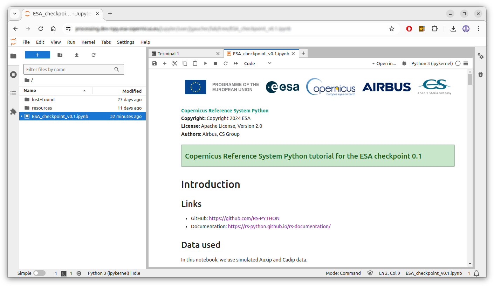

# Local mode

The **local mode** runs the whole RS-Python system on your computer with [Docker Compose](https://docs.docker.com/compose/):
the rs-server services, rs-dpr-service, the mockups of the stations, the databases, an S3 object storage, Prefect,
Dask and a Jupyter server. It is used by the developers to develop and test their changes, and by the CI to run the
demo notebooks. There is no authentication: all the users have all the rights.

The differences with the cluster mode are summarised in
[Developers and contributors](https://github.com/RS-PYTHON/rs-documentation/blob/develop/docs/developers/index.md#local-mode-and-cluster-mode).

## Prerequisites

- [Docker](https://docs.docker.com/engine/install/) with the Compose plugin.
- A GitHub [personal access token](https://docs.github.com/en/authentication/keeping-your-account-and-data-secure/managing-your-personal-access-tokens)
  (classic) with the `read:packages` permission, to pull the Docker images from the
  [GitHub Container Registry](https://github.com/orgs/RS-PYTHON/packages).
- The rs-demo repository:

    ```shell
    git clone https://github.com/RS-PYTHON/rs-demo.git
    cd rs-demo
    ```

## Run

```shell
# Log in to the GitHub Container Registry, with your GitHub login and your personal access token
docker login ghcr.io

# Pull the latest images
cd local-mode
docker compose pull

# Run all the services. Always remove the volumes before, or the catalog database initialisation fails.
# In case of port conflicts, you can remove all your running containers with: docker rm -f $(docker ps -aq)
docker compose down -v; docker compose up  # add -d to run in the background
```

Near the end of the logs, the Jupyter server displays its URL, e.g.
`http://127.0.0.1:8888/lab?token=612cb124335d9ab80a5a6414631a7df186b2401234050001`. Open it in your browser (the token
changes each time the containers are restarted), then open the notebooks of the `demos` or `tutorials` folders:



The Jupyter environment contains the [rs-client-libraries](https://github.com/RS-PYTHON/rs-client-libraries) and
all the environment variables to call the local services. The notebooks run in the Jupyter container, not in your
local Python environment.

To stop everything and remove the volumes:

```shell
docker compose down -v
```

## Services

The [docker-compose.yml](https://github.com/RS-PYTHON/rs-demo/blob/develop/local-mode/docker-compose.yml) file runs:

| Services | URL | Description |
|---|---|---|
| `nginx` | <http://localhost> | Exposes the services behind a single address, like the Envoy Gateway in cluster mode. The Swagger page is at <http://localhost/docs> (for display only). |
| `rs-server-*` | e.g. <http://localhost:8001/docs> (AUXIP), <http://localhost:8002/docs> (CADIP), <http://localhost:8003/catalog/api.html> (catalog), <http://localhost:8005/docs> (PRIP) | The rs-server services. |
| `rs-dpr-service_py<python>-<dask>` | | rs-dpr-service, in a container named after its Python and Dask versions (currently `rs-dpr-service_py3.13.16-2026.7.1`, used for all the processors). |
| `adgs-station`, `cadip-station`, `lta-station`, `prip-station` | | Mockups of the stations, from [rs-testmeans](https://github.com/RS-PYTHON/rs-testmeans). |
| `stac-browser-*` | <http://localhost:8101> (AUXIP), <http://localhost:8102> (CADIP), <http://localhost:8103> (catalog), <http://localhost:8105> (PRIP) | The STAC browsers. |
| `prefect-server`, `prefect-worker-*` | <http://localhost:4200> | The Prefect server and one worker per work pool. |
| `dask-*` | | One container per Dask cluster (staging, CPM3, Level-0, S1 ARD, S3 OLCI, mockup). Each one runs its own Dask Gateway server, as there is no central Dask Gateway in local mode (see [Dask images](https://github.com/RS-PYTHON/rs-workflow-env/blob/develop/docs/dask_images.md)). |
| `postgres`, `catalog-db` | | The PostgreSQL databases: jobs, performance indicators, and the [pgstac](https://github.com/stac-utils/pgstac) catalog. |
| `pgstac-post-actions` | | Runs `scripts/pgstac_post_actions.py` on `catalog-db` (queryables, search by externalIds, indexes...). `rs-server-catalog` starts only after it has completed successfully. |
| `seaweedfs-s3` | <http://localhost:9101> | The [SeaweedFS](https://github.com/seaweedfs/seaweedfs) S3 object storage, with the `S3_ACCESSKEY` and `S3_SECRETKEY` credentials of the `.env` file. |
| `jupyter` | <http://localhost:8888> | The Jupyter server. |

The configuration of the services (stations, buckets...) is in the
[local-mode](https://github.com/RS-PYTHON/rs-demo/tree/develop/local-mode) folder (`.env`, `config/`).

If pulling an rs-dpr-service image fails with `manifest unknown` after a Python or Dask version change, check the
[publication workflow](https://github.com/RS-PYTHON/rs-dpr-service/actions/workflows/publish-binaries.yml) of
rs-dpr-service: the images built with the `latest-temp-cicd` tag are tagged `latest` only after the demo tests pass.
Keep the names of the rs-dpr-service services in `docker-compose.yml` and of their upstream hosts in `nginx.conf`
synchronised when changing these versions.

## Test your local source code

To test your local source code without rebuilding the Docker images, mount it in the containers. For example, if
your rs-server repository is in `/my/local/rs-server`:

1. Copy the Docker Compose file: `cp docker-compose.yml docker-compose-debug.yml`
2. Mount your source code in the containers of `docker-compose-debug.yml`, e.g.:

    ```yaml
    rs-server-adgs:
      # ...
      volumes:
        - /my/local/rs-server/services/common/rs_server_common:/usr/local/lib/python3.13/site-packages/rs_server_common
        - /my/local/rs-server/services/adgs/rs_server_adgs:/usr/local/lib/python3.13/site-packages/rs_server_adgs
        - /my/local/rs-server/services/adgs/config:/usr/local/lib/python3.13/site-packages/config
    ```

3. Run it: `docker compose down -v; docker compose -f docker-compose-debug.yml up`

The same method applies to the rs-client-libraries source code in the `jupyter` and `prefect-*` containers, or to
the rs-dpr-service source code. To debug with breakpoints, attach your IDE to the containers, e.g. with the
[Visual Studio Code Dev Containers](https://code.visualstudio.com/docs/devcontainers/attach-container) extension.
To debug the EOPF and processor code, use the experimental
[LocalCluster configuration](https://github.com/RS-PYTHON/rs-dpr-service/blob/develop/docs/doc/index.md#experimental-configurations)
of rs-dpr-service.

## Run all the notebooks

The CI runs all the notebooks in local mode, with the
[`run-notebooks.sh`](https://github.com/RS-PYTHON/rs-demo/blob/develop/local-mode/run-notebooks.sh) script, to test
the Docker images before publishing them (see [Repositories and CI/CD](https://github.com/RS-PYTHON/rs-documentation/blob/develop/docs/developers/ci-cd.md)).
The notebooks listed in `local-mode/scripts/ignored-notebooks.txt` are skipped.
